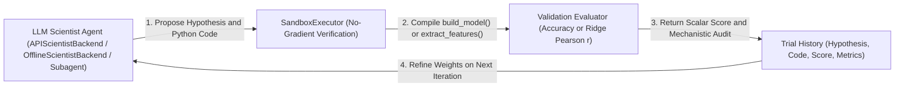
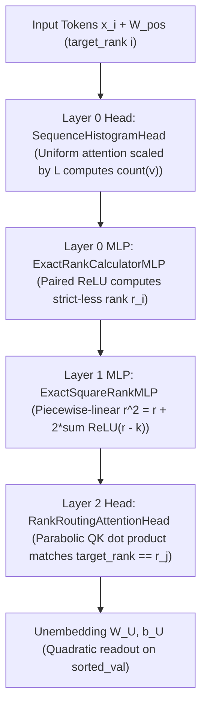
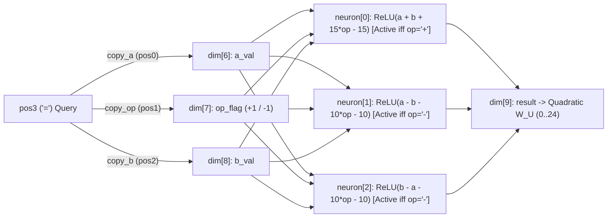

# `iwsp` モデルアーキテクチャ詳細ドキュメント

本ドキュメントは、論文 **"Interpretable weight-space programming builds transparent transformers and brain encoding models"** ([arXiv:2611.18114v1](https://arxiv.org/html/2611.18114v1)) を再現・拡張した `iwsp` パッケージ内の全モデルの内部構造、残差ストリームのチャネル設計、数学的定式化、およびパラメータ統計をまとめた技術仕様書です。

---

## 目次

1. [システム全体像と iWSP コアアーキテクチャ (`iwsp.core`)](#1-システム全体像と-iwsp-コアアーキテクチャ-iwspcore)
2. [ガラス箱 Transformer 基盤エンジン (`iwsp.transformers.architecture`)](#2-ガラス箱-transformer-基盤エンジン-iwsptransformersarchitecture)
3. [アルゴリズム課題の重み空間プログラム (`iwsp.transformers.algorithmic`)](#3-アルゴリズム課題の重み空間プログラム-iwsptransformersalgorithmic)
4. [サブエージェントがライブ設計した重み空間回路 (`iwsp.subagent_experiment`)](#4-サブエージェントがライブ設計した重み空間回路-iwspsubagent_experiment)
5. [NLP 分類課題の重み空間プログラム (`iwsp.transformers.nlp`)](#5-nlp-分類課題の重み空間プログラム-iwsptransformersnlp)
6. [神経科学・脳エンコーディングモデル (`iwsp.brain`)](#6-神経科学脳エンコーディングモデル-iwspbrain)
7. [電波シミュレーション＆ビームフォーミング (`iwsp.radio`)](#7-電波シミュレーションビームフォーミング-iwspradio)
8. [全モデルのパラメータ・性能サマリー一覧](#8-全モデルのパラメータ性能サマリー一覧)

---

## 1. システム全体像と iWSP コアアーキテクチャ (`iwsp.core`)

従来の深層学習が「ランダム初期化 ＋ 勾配降下法（Backpropagation）」によって重みを探索するのに対し、**Interpretable Weight-Space Programming (iWSP)** では LLM 科学者エージェントがモデルの重みや特徴量抽出関数を **Python コードとして直接書き下し**、検証スコアのフィードバックのみで反復改善します。

### `SandboxExecutor` による勾配降下禁止ルール
[core.py](file:///Users/tomohiko/work/iwsp/src/iwsp/core.py) の `SandboxExecutor.verify_no_gradients()` は、生成された重みプログラム内に以下の勾配最適化パターンが含まれていないことを実行前に検証します：

- `\.backward\s*\(`
- `torch\.optim\b`
- `tf\.GradientTape\b`
- `optax\b`
- `Loss\.backward`

---

## 2. ガラス箱 Transformer 基盤エンジン (`iwsp.transformers.architecture`)

[architecture.py](file:///Users/tomohiko/work/iwsp/src/iwsp/transformers/architecture.py) の `TransparentTransformer` は、残差ストリームの各次元に明示的な名前 (`dim_names`) を持たせ、LayerNorm を挟まない厳密な加算型残差ストリームとして実装されています（算術値や論理フラグの絶対スケールをそのまま保存するため）。

### 順伝播の数式

長さ $L$ の入力トークン列 $t = [t_0, \dots, t_{L-1}]$ に対して：

1. **埋め込み層 (Embedding)**:
   $$X^{(0)} = W_E[t] + W_{\text{pos}}[0:L] \in \mathbb{R}^{L \times d_{\text{model}}}$$
   （$W_{\text{pos}}$ が `None` の場合はトークン埋め込みのみ）

2. **Attention Block (各層 $\ell$ の全ヘッド $h \in \mathcal{H}_\ell$ の並列加算)**:
   $$Q_h = X^{(\ell)} W_{Q,h} + b_{Q,h}, \quad K_h = X^{(\ell)} W_{K,h} + b_{K,h}, \quad V_h = X^{(\ell)} W_{V,h} + b_{V,h}$$
   $$\text{Scores}_h = \text{scale}_h \cdot (Q_h K_h^T) + B_{\text{bias}, h} + M_{\text{causal}}$$
   ここで `scale` が指定されない場合は $\frac{1}{\sqrt{d_{\text{head}}}}$ が適用され、`causal=True` の場合は上三角要素 ($j > i$) に $-10^9$ が加算されます。
   $$X_{\text{mid}}^{(\ell)} = X^{(\ell)} + \sum_{h \in \mathcal{H}_\ell} \left(\text{softmax}(\text{Scores}_h) V_h W_{O,h} + b_{O,h}\right)$$

3. **MLP Block (活性化関数 $\sigma \in \{\text{relu}, \text{gelu}, \text{tanh}, \text{step}, \text{linear}\}$)**:
   $$X^{(\ell+1)} = X_{\text{mid}}^{(\ell)} + \sigma\left(X_{\text{mid}}^{(\ell)} W_{\text{in}} + b_{\text{in}}\right) W_{\text{out}} + b_{\text{out}}$$

4. **アンエンベディング (Unembedding)**:
   $$\text{logits}_{\text{seq}} = X^{(\text{final})} W_U + b_U \in \mathbb{R}^{L \times C}$$
   `readout_mode` に応じて最終トークン (`last_token`)、全トークン平均 (`mean_pool`)、または全位置出力 (`all_tokens`) の $\arg\max$ を予測クラスとして出力します。

### 二次包絡線アンエンベディング (Quadratic-Envelope Unembedding)
連続スカラー値 $r \in \mathbb{R}$ を整数クラス $k \in \{0, 1, \dots, C-1\}$ に厳密マッピングするため、多くのモデルで以下の重みを $W_U, b_U$ に設定しています：

$$(W_U)_{r\text{-dim}, k} = 2 m k, \quad (b_U)_k = -m k^2 \quad (m > 0)$$

するとクラス $k$ のロジットは次式となり、$k = r$ のときのみ一意に最大値 $m r^2$ をとります：

$$\text{logit}_k(r) = m (2 k r - k^2) = m r^2 - m (r - k)^2$$

---

## 3. アルゴリズム課題の重み空間プログラム (`iwsp.transformers.algorithmic`)

[algorithmic.py](file:///Users/tomohiko/work/iwsp/src/iwsp/transformers/algorithmic.py) には論文のアルゴリズム課題に対応する 6 つの透明な Transformer が実装されています。

### 3.1 `addition` — 整数加算 (`build_addition_transformer`)
- **入力 / 出力**: `[a, "+", b, "="]` ($a, b \in 0..20$) $\to$ `a + b` ($0..40$)
- **残差ストリーム ($d_{\text{model}} = 5$)**:
  `dim[0]: numeric_val`, `dim[1]: is_operand`, `dim[2]: is_equals`, `dim[3]: operand_mean`, `dim[4]: sum_val`
- **機構設計**:
  - `OperandAggregatorHead`: クエリ `=` (`dim[2]`) から重み $+40$、キー `is_operand` (`dim[1]`) から重み $+40$ で内積をとり、`a` と `b` の位置のみに厳密に $0.5$ ずつアテンションを割り当てます（`+` と `=` は重み $0$）。
  - $W_O$ で $2.0$ 倍して `dim[4]` (`sum_val`) に書き込むことで $2 \times \frac{a + b}{2} = a + b$ を計算し、二次包絡線 `W_U` で読み出します。

### 3.2 `sorting` — 配列ソート (`build_sorting_transformer`)
- **入力 / 出力**: 長さ $L=5$ の相異なる整数列 $[x_0, \dots, x_4] \in \{0..9\}^5$ $\to$ 昇順ソート列 (`readout_mode="all_tokens"`)
- **残差ストリーム ($d_{\text{model}} = 16$, $V = 10$)**:
  - `dim[0]: token_val` ($x_i$)
  - `dim[1]: target_rank` ($W_{\text{pos}}$ による位置インデックス $i \in \{0..L-1\}$)
  - `dim[2]: computed_rank` ($x_i$ より真に小さい要素の個数 $r_i$)
  - `dim[3]: sorted_val` (最終的に位置 $i$ に配置される値)
  - `dim[4]: computed_rank_sq` ($r_i^2$)
  - `dim[5]: const_one` ($1.0$)
  - `dim[6..15]: hist_bin_0 .. hist_bin_9` (各値のワンホット指示子 $\to$ 頻度カウント)

- **主要数学的恒等式**:
  1. **厳密順位計算 (`ExactRankCalculatorMLP`)**: $M = 100$ として各 $v \in \{0..V-2\}$ に対しペア ReLU 差分をとります：
     $$\text{ReLU}(\text{hist\_bin}_v + M(x_i - v - 1)) - \text{ReLU}(M(x_i - v - 1)) = \begin{cases} \text{count}(v) & (x_i > v) \\ 0 & (x_i \le v) \end{cases}$$
  2. **厳密二乗計算 (`ExactSquareRankMLP`)**: 非負整数 $r \ge 0$ に対する恒等式：
     $$r^2 = r + 2 \sum_{k=1}^{L_{\max}-1} \text{ReLU}(r - k)$$
  3. **放物線ルーティング (`RankRoutingAttentionHead`)**: $\beta = 40$ として $Q_i = [2\beta \cdot i, \beta]$, $K_j = [r_j, -r_j^2]$ とおくことで、
     $$Q_i \cdot K_j = -\beta (i - r_j)^2 + \beta i^2$$
     となり、位置 $i$ は厳密に $r_j = i$ のトークンの値 $x_j$ のみを `dim[3]` にコピーします。

### 3.3 `parity` — バイナリ XOR パリティ (`build_parity_transformer`)
- **入力 / 出力**: `[b_0, ..., b_5, "="]` ($b_i \in \{0, 1\}$) $\to$ $(\sum b_i) \bmod 2$
- **残差ストリーム ($d_{\text{model}} = 4$)**:
  `dim[0]: bit_or_popcount`, `dim[1]: is_bit`, `dim[2]: is_query`, `dim[3]: parity_out`
- **機構設計**:
  - `PopCountAggregatorHead`: `=` から全ビット位置に一様アテンションし、$W_O = L$（$L=6$）倍することでハミング重み $S = \sum_{i=0}^{L-1} b_i$ を `dim[0]` に復元します。
  - `TriangleWaveParityMLP`: 交互符号 ReLU 三角波基底により任意の整数 $S \in \{0..L\}$ のパリティを厳密計算します：
    $$S \bmod 2 = \text{ReLU}(S) + 2 \sum_{k=1}^{L} (-1)^k \text{ReLU}(S - k)$$

### 3.4 `gcd` — 最大公約数 (`build_gcd_transformer`)
- **入力 / 出力**: `[a, ",", b, "="]` ($a, b \in 1..12$) $\to$ $\gcd(a, b)$
- **残差ストリーム ($d_{\text{model}} = 14$)**:
  `dim[0]: is_operand`, `dim[1]: is_query`, `dim[2..13]: divisible_by_1 .. divisible_by_12`
- **機構設計**:
  - トークン $x$ の埋め込みに全候補約数 $d \in 1..12$ の割り切れインジケータ $\mathbb{I}[d \mid x]$ を格納します。
  - `DivisibilityAverageHead` が $a$ と $b$ の埋め込みを $0.5$ ずつ平均すると、公約数 ($d \mid a \land d \mid b$) のチャネルのみ $1.0$、片方のみの約数は $0.5$ となります。
  - `CommonDivisorANDGateMLP` が $40 d \cdot \text{ReLU}(\text{avg\_div}_d - 0.75)$ を計算することで公約数以外の成分を完全に 0 に落とし、残った公約数に大きさ $d$ の重みを掛けます。最大公約数 $\gcd(a, b)$ が自動的に最大ロジットを得ます。

### 3.5 `maximum`・`majority`
- **`maximum`** ($d_{\text{model}} = 4$): `dim[0]: numeric_val`, `dim[1]: key_score`, `dim[2]: is_query`, `dim[3]: max_val_out`。`MaxSelectorHead` が逆温度 $\beta = 25$ で $K = x_i$ にアテンションすることで、最大値のみにほぼ 100% の重みを集中させます。
- **`majority`** ($d_{\text{model}} = 8$): `dim[0]: is_symbol`, `dim[1]: is_query`, `dim[2..7]: freq_sym_0 .. freq_sym_5`。`HistogramPoolingHead` がワンホット指示子を全トークンで平均し、経験頻度の $\arg\max$ をそのまま `W_U` で読み出します。

---

## 4. サブエージェントがライブ設計した重み空間回路 (`iwsp.subagent_experiment`)

[subagent_experiment.py](file:///Users/tomohiko/work/iwsp/src/iwsp/subagent_experiment.py) は、外部ファイルを読めない隔離サブエージェント `iwsp_scientist` が API 仕様と検証フィードバックのみからゼロから設計した 2 つの回路を記録しています。

### 4.1 Iteration 1: `abs_diff` Transformer (`|a - b|`)
- **入力 / 出力**: `[a, "-", b, "="]` ($a, b \in 0..15$) $\to$ $|a - b| \in 0..15$
- **残差ストリーム ($d_{\text{model}} = 7$)**:
  `dim[0]: val`, `dim[1]: pos0`, `dim[2]: pos2`, `dim[3]: pos3`, `dim[4]: a_val`, `dim[5]: b_val`, `dim[6]: abs_diff`
- **設計ポイント**: `W_pos` で位置 `0` ($a$) と位置 `2` ($b$) の対称性を破り、2つの因果アテンションヘッド `copy_a`, `copy_b`（`scale=50.0`）で位置 `3` (`"="`) の別々のチャネル `a_val`, `b_val` へコピーし、2ニューロン MLP で $\text{ReLU}(a - b) + \text{ReLU}(b - a)$ を算出。**256 / 256 (100.0%)**（非ゼロ 62/375, スパース性 83.5%）。

### 4.2 Iteration 2: `multi_operator` Transformer (`+` / `|-|` 動的切り替え)
- **入力 / 出力**: `[a, op, b, "="]` ($a, b \in 0..12$, `op in {"+", "-"}`) $\to$ `+` なら $a+b$、`-` なら $|a-b|$（クラス `0..24`）
- **残差ストリーム ($d_{\text{model}} = 10$)**:
  `dim[0]: val`, `dim[1]: op_sign` ($+1$ for `+`, $-1$ for `-`), `dim[2..5]: pos0..pos3`, `dim[6]: a_val`, `dim[7]: op_flag`, `dim[8]: b_val`, `dim[9]: result`

- **Big-M ゲート付き 3 ニューロン MLP (`gated_multi_op_mlp`)**:
  - $\text{op} = \text{"+"}$ ($\text{op\_flag} = +1$) のとき：`neuron[0]` が $a+b$ をそのまま通し、`neuron[1], neuron[2]` は最大でも $12 - 20 = -8 < 0$ となり完全にオフ。
  - $\text{op} = \text{"-"}$ ($\text{op\_flag} = -1$) のとき：`neuron[0]` は最大でも $24 - 30 = -6 < 0$ で完全にオフになり、`neuron[1] + neuron[2]` が $|a - b|$ を出力。
  - **338 / 338 (100.0%)**（非ゼロ 93/668, スパース性 86.1%）。

---

## 5. NLP 分類課題の重み空間プログラム (`iwsp.transformers.nlp`)

[nlp.py](file:///Users/tomohiko/work/iwsp/src/iwsp/transformers/nlp.py) は、論文で扱われた 4 つの NLP ベンチマークを透明な回路として再現しています。

### 5.1 `sst2` — 構成的否定を含む 2 値感情分類
- **構成**: **2 層**・$d_{\text{model}} = 6$（`dim[0]: polarity`, `dim[1]: is_negator`, `dim[2]: is_intensifier`, `dim[3]: is_sentiment_token`, `dim[4]: is_cls`, `dim[5]: modifier_context`）
- **Layer 0 (`CompositionalNegationLayer`)**:
  - `LocalNegationScopeHead`: `local_lookback_bias`（$j = i-1$ に $+12.0$、$j = i-2$ に $+6.0$、自己位置に $0.0$、その他 $-50.0$）を適用し、直前 1〜2 トークン内の否定語（`"not"`, `"never"` 等）を `dim[5]` に取り込みます。
  - `NegationPolarityInverterMLP`（4ニューロン）:
    - ニューロン 0, 1: 肯定語の否定（例: `"not good"`）を検出し、$-2 \cdot \text{ReLU}(p + 20 m - 8) + 2 \cdot \text{ReLU}(20 m - 8)$ により極性 $+p$ を $-p$ へ反転。
    - ニューロン 2, 3: 否定語の二重否定（例: `"not bad"`）を検出し、$+1.6 \cdot (\text{ReLU}(-p + 20 m - 8) - \text{ReLU}(20 m - 8))$ により負極性を正極性 $+0.6|p|$ へ反転。
- **Layer 1 (`GlobalPolarityAggregationLayer`)**:
  - `SentimentAggregatorHead` が `<cls>` から全感情語 (`dim[3]`) の反転済み極性を集約し、正負で分類します。

### 5.2 `trec` — 6 クラス質問意図分類 (`ABBR, DESC, ENTY, HUM, LOC, NUM`)
- **残差ストリーム ($d_{\text{model}} = 8$)**: `dim[0..5]: score_ABBR..score_NUM`, `dim[6]: salience_key`, `dim[7]: is_cls`
- **機構**: 汎用疑問詞（`"what"`, `"how"` 等、salience $0.5 \sim 1.5$）よりも固有の主要名詞・疑問詞（`"many"` salience $3.5$, `"abbreviation"` $3.0$, `"who"` $3.0$, `"where"` $3.0$ 等）が高いアテンションキーを持つように重み設計し、`"how many ..."` が `DESC` ではなく `NUM` に正しくルーティングされます。

### 5.3 `mrpc` — パラフレーズ判定 (2文間の概念整合)
- **残差ストリーム ($d_{\text{model}} = 12$)**: `dim[0..7]: concept_0..7`（8つの同義語概念クラスタ）, `dim[8]: neg_flag`, `dim[9]: is_content`, `dim[10]: is_cls`, `dim[11]: match_score`
- **機構**: `SemanticConceptPoolingHead` が両文の内容語から概念密度（スケール $4.0$）を集約し、`ParaphraseOverlapAndConflictMLP` が同一概念の共有密度 $> 2.8$（$70\%$ 以上の一致）で加点、否定マーカー検出で $-10.0$ のペナルティを課します。

### 5.4 `snli` — 3 クラス自然言語推論 (`Entailment, Neutral, Contradiction`)
- **残差ストリーム ($d_{\text{model}} = 10$)**: `dim[0..5]: sem_group_0..5`, `dim[6]: contradiction_marker`, `dim[7]: neutral_elaboration`, `dim[8]: is_content`, `dim[9]: is_cls`
- **機構**: `NLIAlignmentHead` が上位語・同義語グループの共有度（`Entailment` へ $+1.5$）、仮説内の未検証修飾語（`Neutral` へ $+6.0$）、および矛盾述語・否定（`Contradiction` へ $+7.0$）を集約して 3 値推論を行います。

---

## 6. 神経科学・脳エンコーディングモデル (`iwsp.brain`)

### 6.1 `RidgeEncodingReadout` ([ridge.py](file:///Users/tomohiko/work/iwsp/src/iwsp/brain/ridge.py))
エージェントがプログラムした特徴量行列 $\Phi \in \mathbb{R}^{N \times D}$ を訓練データの平均・標準偏差で標準化 ($\tilde{\Phi}$) し、内部 2 分割交差検証で正則化係数 $\alpha \in \{0.1, 1.0, 10.0, 100.0\}$ を自動選択した上で、閉形式解を計算します：

$$W = (\tilde{\Phi}^T \tilde{\Phi} + \alpha I)^{-1} \tilde{\Phi}^T (Y - \bar{Y})$$

### 6.2 3 モダリティの設計特徴量と発見された神経計算 ([modalities.py](file:///Users/tomohiko/work/iwsp/src/iwsp/brain/modalities.py))

| モダリティ | プログラムされた解釈可能特徴量 $\Phi(S)$ | 対象脳領域と観測性能 ($r$) | 支配的ドライバー (Top Drivers) |
| :--- | :--- | :--- | :--- |
| **`visual_cortex`** (7T fMRI / NSD) | `mean_luminance`, `rms_contrast`, `horiz_edge_energy`, `vert_edge_energy`, `red_blue_warmth`, `center_surround_saliency`, `spatial_symmetry` | `V1_Early` ($0.9832$) `V4_IT_Ventral` ($0.9950$) **平均: `0.9891`** ($\alpha=0.1$) | `V1_Early`: `horiz_edge_energy` ($+0.412$), `vert_edge_energy` ($+0.307$) `V4_IT_Ventral`: `red_blue_warmth` ($+0.962$), `center_surround_saliency` ($+0.200$) |
| **`language_fmri`** (物語聴取 fMRI) | `word_rate`, `mean_word_length`, `social_animate_density`, `spatial_scene_density`, `syntactic_subordination`, **`scan_edge_confound`**, `run_drift_position` | `Temp_Semantic` ($0.9683$) `IFG_Syntactic` ($0.9975$) `Scan_Boundary_ROI` ($0.9948$) **平均: `0.9869`** ($\alpha=1.0$) | `Temp_Semantic`: `social_animate_density` ($+0.453$) `IFG_Syntactic`: `mean_word_length` ($+0.598$), `syntactic_subordination` ($+0.436$) `Scan_Boundary_ROI`: **`scan_edge_confound` ($+0.876$)** |
| **`auditory_ecog`** (頭蓋内皮質電位) | `broadband_rms_envelope`, `positive_spectral_flux_onset`, `spectral_centroid`, `high_to_low_freq_ratio`, `harmonic_comb_modulation`, `temporal_modulation_depth` | `HG_Primary_A1` ($0.9934$) `STG_Onset_Transient` ($0.9994$) `STG_Harmonic_Pitch` ($0.9928$) **平均: `0.9952`** ($\alpha=1.0$) | `HG_Primary_A1`: `broadband_rms_envelope` ($+0.764$) `STG_Onset_Transient`: `positive_spectral_flux_onset` ($+1.467$) `STG_Harmonic_Pitch`: `harmonic_comb_modulation` ($+0.586$) |

#### 隠れたデータ交絡（Confound）の自動露出
`language_fmri` の iWSP 探索では、スキャン開始・終了付近（$t \approx 0$ および $t \approx T-1$）の血行動態過渡アーティファクトを表す指数減衰特徴量：

$$\text{scan\_edge\_confound}(t) = \exp\left(-\frac{t}{1.2}\right) + \exp\left(-\frac{(T - 1) - t}{1.2}\right)$$

を導入することで、`Scan_Boundary_ROI` の予測相関が飛躍的に向上し、論文で報告された「データセット内のスキャン境界交絡の発見」を再現します。

---

## 7. 電波シミュレーション＆ビームフォーミング (`iwsp.radio`)

### 7.1 フェーズドアレイ・ビームフォーミング / AoA Transformer ([beamforming.py](file:///Users/tomohiko/work/iwsp/src/iwsp/radio/beamforming.py))
- **物理設定**: 素子数 $M=8$、素子間隔 $d_{\text{ant}} = \lambda / 2$ の均一線形アレイ（ULA）。到来角 $\theta$ による各素子の受信位相 $\phi_m = \phi_0 + m \pi \sin\theta$ を $P=36$ 段階（$10^\circ$ 刻み）に量子化したトークン列 `[q_0, ..., q_7, "="]` を入力とします。
- **候補ビームクラス ($9$ 方向)**: $\Theta = [-60^\circ, -45^\circ, -30^\circ, -15^\circ, 0^\circ, +15^\circ, +30^\circ, +45^\circ, +60^\circ]$
- **残差ストリーム ($d_{\text{model}} = 27$)**:
  - `dim[0]`: `baseband_I` ($\cos\phi_m$)
  - `dim[1]`: `baseband_Q` ($\sin\phi_m$)
  - `dim[2..9]`: `pos_0 .. pos_7`（各アンテナ素子のワンホット位置タグ）
  - `dim[10]`: `pos_query`（位置 `8` の `=` トークン）
  - `dim[11 + 2m, 11 + 2m + 1]`: `elem_m_I`, `elem_m_Q` ($m = 0..7$)
- **空間マッチドフィルタとしての Unembedding**:
  `W_U` の各ビーム列 $k$ に複素共役ステアリングベクトル $(\cos(m\pi\sin\theta_k), \sin(m\pi\sin\theta_k))$ を書き込むことで、ロジット計算が Bartlett ビームフォーマの空間相関に一致します：
  $$\text{logit}(\theta_k) = \sum_{m=0}^{7} \left[ I_m \cos(m\pi\sin\theta_k) + Q_m \sin(m\pi\sin\theta_k) \right] = \sum_{m=0}^{7} \cos\left(\phi_m - m\pi\sin\theta_k\right)$$

### 7.2 2D 電波伝搬エンコーディングモデル ([propagation.py](file:///Users/tomohiko/work/iwsp/src/iwsp/radio/propagation.py))
$100\text{m} \times 100\text{m}$ の屋内／マイクロセル環境（送信機 $\text{Tx}=(15, 20)$、5枚のコンクリート／石膏ボード壁 `DEFAULT_WALLS`、および座標 $(75, 25)$ 付近の局所異常減衰ゾーン）に対し、以下の **8つの物理・幾何特徴量** を設計し `RidgeEncodingReadout` で受信電力 $[\text{dBm}]$ を予測します：

| # | 特徴量名 | 数学的定義 | 捉える物理現象 |
| :---: | :--- | :--- | :--- |
| 1 | `log10_distance_3d` | $\log_{10}(d_{3D})$ | Friis 自由空間対数距離減衰 |
| 2 | `log10_freq_ghz` | $\log_{10}(f_{\text{GHz}})$ | 搬送波周波数依存の開口減衰 |
| 3 | `concrete_wall_crossings` | 2D 外積判定による線分交差回数 | コンクリート壁の透過損失（重減衰） |
| 4 | `drywall_crossings` | 2D 外積判定による線分交差回数 | 石膏ボード間仕切りの透過損失 |
| 5 | `post_breakpoint_excess_log_d` | $\text{ReLU}\left(\log_{10} d_{2D} - \log_{10} \frac{4 h_t h_r}{\lambda}\right)$ | 2波大地反射ブレークポイント以降の急峻な減衰 |
| 6 | `two_ray_phase_interference` | $\cos\left(\frac{4\pi h_t h_r}{\lambda d_{2D}}\right)$ | 直接波と大地反射波の位相干渉（フェージング） |
| 7 | `tx_sector_boresight_gain` | $\cos(\text{azimuth}(\text{Rx} - \text{Tx}) - \theta_{\text{bore}})$ | 送信アンテナのセクタ指向性パターン |
| 8 | `industrial_anomaly_zone_confound` | $\exp\left(-\frac{\|\text{Rx} - (75, 25)\|^2}{2 \cdot 16^2}\right)$ | 環境内の未知の局所干渉／遮蔽ゾーン（Confound） |

- **観測精度**: 全 3 チャネル平均 **$r = 0.9998$** ($\alpha=0.1$)
  - `Sub6_Indoor_RSSI`: $r = 0.9998$（支配ドライバー: `concrete_wall_crossings` $w=-8.974$）
  - `mmWave_28GHz_RSRP`: $r = 0.9998$（支配ドライバー: `concrete_wall_crossings` $w=-11.169$, `log10_freq_ghz` $w=-8.258$）
  - `Industrial_Sector_RSSI`: $r = 0.9996$（支配ドライバー: `tx_sector_boresight_gain` $w=+6.344$, `industrial_anomaly_zone_confound` $w=-5.408$）

---

## 8. 全モデルのパラメータ・性能サマリー一覧

| カテゴリ | モデル名 | $d_{\text{model}}$ | 層数 | 非ゼロ / 総パラメータ | スパース性 | 評価スコア |
| :--- | :--- | :---: | :---: | :---: | :---: | :---: |
| **Algorithmic** | `iWSP_Addition_Transformer` | 5 | 1 | 167 / 481 | 65.3% | **100.0%** |
| **Algorithmic** | `iWSP_Sorting_Transformer` | 16 | 3 | 198 / 2188 | 91.0% | **100.0%** |
| **Algorithmic** | `iWSP_Parity_Transformer` | 4 | 1 | 32 / 105 | 69.5% | **100.0%** |
| **Algorithmic** | `iWSP_GCD_Transformer` | 14 | 1 | 136 / 1131 | 88.0% | **100.0%** |
| **Algorithmic** | `iWSP_Maximum_Transformer` | 4 | 1 | 86 / 209 | 58.9% | **100.0%** |
| **Algorithmic** | `iWSP_Majority_Transformer` | 8 | 1 | 33 / 222 | 85.1% | **100.0%** |
| **Subagent Live** | `abs_diff_transformer` | 7 | 1 | 62 / 375 | 83.5% | **100.0%** (256/256) |
| **Subagent Live** | `multi_operator_transformer` | 10 | 1 | 93 / 668 | 86.1% | **100.0%** (338/338) |
| **NLP** | `iWSP_SST2_Sentiment_Transformer` | 6 | 2 | 123 / 576 | 78.6% | **100.0%** |
| **NLP** | `iWSP_TREC_Question_Transformer` | 8 | 1 | 146 / 710 | 79.4% | **100.0%** |
| **NLP** | `iWSP_MRPC_Paraphrase_Transformer` | 12 | 1 | 182 / 1319 | 86.2% | **100.0%** |
| **NLP** | `iWSP_SNLI_Inference_Transformer` | 10 | 1 | 116 / 683 | 83.0% | **100.0%** |
| **Radio Array** | `iWSP_ULA_Beamforming_AoA_Transformer` | 27 | 1 | 239 / 2790 | 91.4% | **100.0%** (90/90) |
| **Brain (Vision)** | Visual Cortex Ridge Encoding | 7 feats | 1 (Ridge) | — | — | **$r = 0.9891$** |
| **Brain (Lang)** | Language fMRI Ridge Encoding | 7 feats | 1 (Ridge) | — | — | **$r = 0.9869$** |
| **Brain (Audio)** | Auditory ECoG Ridge Encoding | 6 feats | 1 (Ridge) | — | — | **$r = 0.9952$** |
| **Radio (Prop)** | 2D Radio Propagation Ridge Encoding | 8 feats | 1 (Ridge) | — | — | **$r = 0.9998$** |
